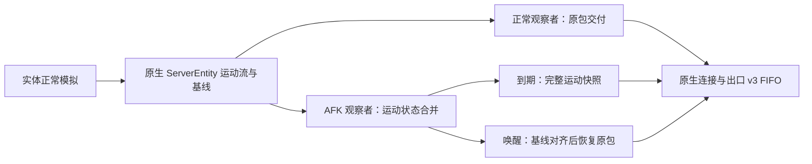

# AFK 实体同步：识别、降频与恢复方案

日期：2026-10-20。范围：`2.0.0`，优先 **1.20.1 Forge / 1.21.1 NeoForge**。

状态：源码调研与设计方案完成；[R0 离线运动流回放](r0-entity-motion-replay-2026-10-20.md)已在两个重点版本通过。**未实现识别器、实际节流或线上恢复协议，未实测新增收益**。本文的时间、频率、预算都是原型实验候选，不是产品默认值。

上游入口：[计划 A](research-2026-10-20-packet-afk.md)；测量依据：[首轮流量画像](traffic-profile-2026-10-20.md)。

## 1. 推荐方向

采用“客户端报告操作意图，服务端决定策略；按实际观察者分别交付；只合并已证明可重建的实体运动状态”。服务器的 AI、物理、伤害、拾取、农场和世界 tick 保持正常。

分两步验证，但两步都在本方案中定义边界：

1. **共享节拍原型**：只对全部实际观察者均允许降频的实体增加 AFK 间隔。有一个正常、未知、恢复中或受保护的观察者就不增加 AFK 间隔。成本较低，可以先验证识别与唤醒；混合观察者下暂不获得额外 AFK 收益。
2. **每观察者运动快照原型**：正常玩家继续收到现有原生包；AFK 玩家在独立的交付状态中低频收到完整运动快照。恢复时先把其位置解码基线接回原生广播流，再放行相对位移。它解决混合观察者的带宽问题，不需要给每位玩家复制一套实体模拟。

第二步的关键不只是计时器，而是快照、原生运动流、出生/销毁与恢复之间的顺序契约。不能将“任意丢包＋退出时发一个传送包”当作已解决。

首轮真实工厂约 61.16% 的原生字节来自实体移动，另有 14.33% 来自其他实体状态；本方案首版主要针对前者。元数据、生成/销毁等仍即时交付，不能把合计 75.49% 直接当作本方案可节省比例。

## 2. BandwidthOptimizer 参考结论

已读取本地 `D:/project/MC/BandwidthOptimizer`，HEAD 为 `9f9483b57c9d649eafa3547855178a311b4d2159`，remote 为 `duckgun13476/BandwidthOptimizer`。读取时无受版本管理文件的修改；`.codegraph/` 是未跟踪索引。以下为该 checkout 的源码事实，不是对最新发行版的性能验证。

| 参考点 | 代码证据 | 对 Hassium 的取舍 |
|---|---|---|
| 前台静止与后台挂机分级 | `gate/IdleGateClientController.java:13`、`:77`；前台 20 秒、后台 2 秒，入世界宽限 30 秒 | 借鉴分级和宽限；“长期挂机”先试更保守的时间，不照搬 2 秒后台即深度挂机 |
| 判断位置/视角变化，不以攻击包续期 | 同文件 `:121`；相邻采样位移平方阈值 0.0004、角度 0.1° | 能容纳长按/重复攻击；改为锚点与累计变化检测，避免缓慢移动一直低于逐帧阈值 |
| 变化立即上报，稳定状态心跳 | 同文件 `:88`、`:113`；服务端 `IdleGateServerState.java:19`、`:71` 处理过期状态 | 借鉴租约；增加会话代、单调序号校验。过期进入恢复，不能跳过基线修复直接放行 |
| 前台按观察者视角与距离判断 | `gate/integration/minecraft/IdleGateForegroundEntityViewPolicy.java:25`、`:43`；8 格近区保留、宽视锥、每 tick 有界缓存 | 借鉴近区保护和按观察者决策；视锥只是质量提示，第三人称、自由相机与 Mod 视角不可靠时保持正常 |
| 合并为实体 ID＋状态种类，退出时重建 | `gate/recovery/EntityMotionRecoveryPolicy.java:39`、`:127`、`:189`；每玩家至多 4096 条，恢复发送绝对位置/速度 | 借鉴有界状态和“当前状态替代历史回放”；补充世界/实体生命周期身份、头部朝向和原生位置基线约束 |
| 队列代、换维度清理、限额扫描 | `gate/integration/minecraft/ActiveEntityViewGate.java:39`、`:254`、`:295`、`:340` | 借鉴队列 generation 和调度预算。这里的队列 generation 不等于完整的实体生命周期身份 |

BO 的 `EntityMotionPacketCompat.java:15` 使用 `new ClientboundTeleportEntityPacket(entity)`；恢复策略在 tick 中执行，见 `IdleGateRecoveryRegistry.java:171`。已读方法没有显式把恢复坐标绑定到 `ServerEntity.positionCodec` 的广播基线。其回归测试覆盖合并、队列代、换维度和容量，但不构成真实客户端位置解码的正确性证明。

这是 Hassium 移植时必须验证的设计缺口，**本轮没有运行 BO，也不据此宣称 BO 已被实测发现故障**。根目录 LICENSE 为 LGPL 2.1；本轮只借鉴设计，没有复制源码。

## 3. 原版与当前 Hassium 的硬约束

已用 minecraft-dev 核对两个重点版本的 Mojmap 源码：

- `ChunkMap.TrackedEntity` 持有一份 `ServerEntity`，向 `seenBy` 中各连接广播同一个包；观察者集合由原版跟踪规则维护。1.21.1 还检查该玩家是否真正跟踪实体所在区块，不能仅靠玩家与实体的距离重建集合。
- `ServerEntity.sendChanges` 使用共享的 `positionCodec` 生成相对位移；广播位置包后才更新基线。元数据 dirty 也能触发该分支，因此单纯增大 `updateInterval` 不保证运动包严格按新频率产生。
- `VecDeltaCodec` 在 1/4096 格网格上编码位移，客户端按收到的相对包推进自己的位置基线。客户端渲染/插值位置不能代替包解码基线。
- 两版 `ClientPacketListener.handleTeleportEntity` 会重置位置 codec；`handleMoveEntity` 从该 codec 解码下一次相对位移。
- 1.21.1 `ServerEntity` 有 `getPositionBase`、最后发送速度/朝向等 getter；1.20.1 缺少相同公开接口。`new ClientboundTeleportEntityPacket(entity)` 在两版都取实体的当前 `trackingPosition`，并不自动取共享广播基线。

Hassium 现有入口：

- [`EntityUpdatePacing`](../../common/src/main/java/io/github/limuqy/mc/hassium/server/entity/EntityUpdatePacing.java) 的 `computeEffectiveInterval` / `nearestObserver` 根据距离、密度和最近玩家压力决定共享节拍。其观察范围刻意取宽，可用于现有保守策略，不能直接当作新的精确 AFK 观察者集合。
- [`MixinServerEntity`](../../common/src/main/java/io/github/limuqy/mc/hassium/mixin/server/MixinServerEntity.java) 只改节拍、相位和 impulse 门，不取消整个 `sendChanges`。AFK 也不能跳过 tickCount、dirty 数据、乘客或 hurtMarked 等必要路径。
- [`EntityLerpPacing`](../../common/src/main/java/io/github/limuqy/mc/hassium/client/EntityLerpPacing.java) 自适应上限为 20 tick；不能简单把上限放大到几十秒。低频绝对快照允许表现变粗，恢复时须清理 AFK 期间的插值历史。
- [出口 v3](../egress-v3.md) 已维护 FIFO、Bundle、回调和压缩历史。节流应在实体语义/逐观察者分发层、原生编码之前作决定；已编码或进入聚合历史的包和帧不得事后删除。

## 4. 识别：按意图分类，不按包数量判断

### 4.1 两个独立维度

记录 `活动状态` 与 `观察偏好`。活动状态候选为：

`ACTIVE → IDLE_CANDIDATE → AFK_LIGHT / AFK_DEEP → RESUMING → ACTIVE`

观察偏好提供“自动”“保持实时观察”“主动挂机”。静止观察与固定节奏挂机可以具有相同输入，无法仅凭流量可靠区分人的意图。“保持实时观察”优先于自动静止判断；主动挂机也不取消自身状态和交互相关实体保护。

客户端负责原始移动/视角意图、GUI 活动、焦点与按键模式；服务端负责实际位置、动作目标、伤害、载具与世界生命周期。未协商新能力、报告未知或原版客户端，在 AFK 策略中按 ACTIVE 处理；原有实体优化照常生效。

### 4.2 信号决策表

| 信号 | 对活动状态的建议 | 对数据交付的处理 |
|---|---|---|
| 主动移动键、有效鼠标转向、切物品栏、打开/操作 GUI、新聊天/命令、主动退出 AFK | 立即请求 RESUMING；即使撞墙导致位置不变，也属于明确意图 | 相关交互与控制先正常处理，不等待远处实体全部恢复 |
| 位置/视角长期稳定，无操作 | 进入候选；有“实时观察”偏好则保持正常 | 候选期不降频，确认后只影响允许的运动状态 |
| 攻击键一直按住、同一目标的稳定重复攻击/挥手 | 可以继续累计 AFK 候选时间，不因每个动作包重置 | 动作本身完整执行；当前攻击目标与近区实体正常同步 |
| 间隔攻击 | 记录周期、目标区域/关系和物品栏；固定重复模式是 AFK 的辅助证据，不是必然结论 | 模式变化或主动改换目标时恢复/重新确认；刷怪同一区域内的实体死亡/新生不单凭 ID 变化认作真人活动 |
| 长按使用/右键自动化 | 已知、稳定且有语义适配的模式可候选；未知模式阻止自动进入，显式挂机仍可只优化无关实体 | 自身使用状态、鱼漂、载具、交互目标保持正常；不拦截上行动作 |
| 窗口失焦、最小化 | 仅作“允许更粗表现”的提示，不单独证明长期 AFK | 已确认挂机且租约有效时才考虑 DEEP；焦点恢复立即请求恢复 |
| 玩家受伤、死亡、传送、换维度、载具控制、被服务器移动 | 中止当前 AFK 优化并恢复/重建；被动移动不宣称为真人活动 | 自身及关联实体立即正常，换世界清理旧代 |
| keepalive、普通移动包心跳、协议 ACK | 不作为活动证据 | 始终维持原协议及时性，不进入 AFK 合并 |

重复模式先用低成本摘要，不尝试识别外挂或绕过反作弊：例如至少 30 秒、8 个周期，目标/槽位稳定，周期离散程度低于候选阈值。未满足时保持保守。真人也可能规律点击，宏也可能随机化，因此自动识别始终保留不确定性和手动选择。

### 4.3 第一轮实验参数

| 项 | 候选值/规则 | 原因 |
|---|---|---|
| 入世界/换维度宽限 | 30 秒，且初始跟踪已稳定 | 避免登录和载入期间进入 AFK |
| 静止候选 / 自动 LIGHT | 60 秒 / 120 秒 | 符合长期不动口径，比 BO 的前台 20 秒保守 |
| 位置/视角容差 | 相对固定锚点约 0.1 格、1°，另统计累计变化；角度按环绕差计算 | 容忍噪声，但不让每帧小位移、慢转头无限逃过判断 |
| DEEP | 已确认挂机且主动选择，或挂机后持续后台约 30 秒；未知相机/交互模式不升级 | 后台本身不构成 AFK |
| 状态报告 | 改变时立即发送，稳定时约 15 秒一次；服务端租约约 45 秒 | 心跳成本小；报告丢失时结束降频 |
| 恢复后的正常宽限 | 约 5 秒 | 避免焦点切换/微小抖动造成反复进出 |

使用本地/服务端各自的单调时钟计时，不相信客户端绝对时间。上报携带会话代、递增序号、模式/观察偏好和必要模式摘要；服务端拒绝旧代/旧序号，并可因观察到明确交互覆盖 AFK。报告只决定该连接的表现质量，不获得修改模拟或其他玩家质量的权限。

租约过期的逻辑含义是“停止承认 AFK”，其传输动作仍是 RESUMING：已漏收相对位移的实体必须先修复基线。

## 5. 降频范围与节拍

### 5.1 允许与豁免

首版允许列表：已知原版、无特殊控制关系的掉落物、经验球及被动生物的 `MoveEntity(Pos/Rot/PosRot)`、速度、头部朝向。未知/自定义实体需单独适配，不按包名通杀。

以下持续即时交付：出生/销毁、玩家信息、元数据、装备/属性、乘客/牵引关系、拾取、伤害/死亡/关键动画、实体的原生绝对传送，以及全部玩家自身、容器、物品栏、交互确认、连接/配置控制。声音、粒子、方块和 Mod payload 本轮不扩围。

按“观察者—实体”建立豁免：自身和其他玩家、约 8 格交互近区、当前/近期攻击或使用目标、自身鱼漂、坐骑及其乘客链、可控实体、战斗威胁、投射物/爆炸物和未知 Mod 实体。保护应有退出迟滞，目标每 tick 换实体 ID 时按空间/关系延续。未知关系保持正常。

持弓、瞄准、战斗等会受远处目标位置影响的行为，可直接使玩家进入恢复宽限，而不只保护一个现有 target ID。长按刷怪保留攻击目标与近区；远处非交互实体仍可降频，因此“存在攻击包”不等于整条连接永远退出 AFK。

### 5.2 频率候选

`I0` 表示关闭新增 AFK 功能时，现有 Hassium 优化产生的节拍，绝不是强行恢复为全实体 20 Hz。

| 状态/实体关系 | 候选交付 |
|---|---|
| ACTIVE、候选、未知、实时观察、豁免关系 | 保持 I0 |
| LIGHT：视野内或视角不可靠 | 首版保持 I0；更粗的可见区质量另做显式选项 |
| LIGHT：可靠判断为视野外、非交互实体 | 试验约 1 秒一次完整运动快照 |
| DEEP：非交互实体 | 试验约 2 秒一次完整运动快照；只对变脏状态发送 |
| 恢复中 | 逐实体先对齐基线，再回到 I0；交互/可见/近处优先 |

“1/2 秒”约束的是相对 I0 广播状态增加的等待；实际世界状态年龄还包含 I0、本轮 tick 等待与出口排队。低 TPS 时必须报告真实年龄，不能仍宣称硬性 1/2 秒。

以到期时间与实体/观察者稳定散列错峰。保留每实体最新运动状态与 dirty 标记，不积累几分钟的相对包列表。不因近区/可见区保护的存在承诺所有挂机场景都有明显收益。

完整快照比单个相对包大。位置＋速度＋头部朝向在常见 ID 长度下约 40–45 B 的原始负载量级，实际还受封装/聚合影响；若 I0 已很低频，再每秒重发完整状态可能反而增流。准入需比较候选快照成本、原流频率与允许陈旧时间；不划算的实体保持 I0，最终依据实际 TCP 写出量验证。

## 6. 同一实体的混合观察者

### 6.1 共享节拍阶段的安全边界

取原版实际 `seenBy`/配对集合，而非最近玩家：

- 所有实际观察者都确认允许降低该实体质量时，才能增加共享 AFK 间隔；取他们要求中最严格的频率。
- 任何 ACTIVE、候选、恢复中、未知、未协商、近区/交互豁免观察者，均阻止额外共享降频。最近玩家 AFK、较远玩家活动时尤其不能只看最近者。
- 新活动观察者配对、现有玩家唤醒，要在下一轮实体跟踪生成包前撤销 AFK 因子。
- 仍保留原版 dirty、impulse 的必要语义；如果 dirty 持续带出运动包，应记录其占比，不能通过丢元数据或取消整个方法来制造收益。
- 先遵守现有 20 tick 插值/间隔边界。DEEP 的两秒快照属于第二阶段，不能通过直接增大现有 `MAX_INTERVAL` 实现。

这一阶段混合观察者都保持原同步质量，是明确的功能边界，不宣称已实现逐连接省流。

### 6.2 推荐的完整方案：每观察者运动快照

共享原生流不为 AFK 观察者额外减速；正常观察者不进入 AFK 分支，也不接收为他人生成的修复包。AFK 分支是减少副本，不是修改一个共享 Packet 对象再发给不同玩家。

**还须隔离现有压力反馈。** 当前 `EntityPacketCounters` 在 `Connection.send` 计数，下一 tick 用它更新每玩家压力；共享节拍再读取最近观察者的压力。如果把 AFK 合并后的低包数直接喂回这一链路，最近 AFK 玩家可能改变正常观察者的 I0，产生交叉影响。第二阶段应分别记录“AFK 门之前的原生交付需求”和“实际交付/快照/恢复量”：前者继续供现有共享策略使用，后者用于 AFK 收益与独立预算；替代快照不重复计入原生需求。混合玩家实验必须覆盖这个反馈环，而不只比较分发函数。

逐观察者交付状态独立于玩家识别状态：`PASS → HOLD → REBASE_PENDING → PASS`。HOLD 中即使偶尔收到原生绝对传送，也不能随意放行下一条相对包；所有相对包的放行都要符合当前交付状态。

维护两层信息：

| 层 | 必要状态 |
|---|---|
| 实体原生运动账本 | 广播位置基线 B、最后广播的身体/头部朝向与速度、ground、单调运动版本、实体/跟踪代；在生成原生运动流之后封存 |
| 观察者交付记录 | connectionEpoch、worldEpoch、entityUUID、entityId、trackingGeneration、PASS/HOLD/REBASE、dirty mask、已交付运动版本、到期与恢复优先级 |

`B` 是原生编码流的基准，不是 `entity.getX()`、碰撞盒位置或客户端当前插值位置。读取账本/构造快照在真实服务器线程执行，Netty 只消费不可变、已排序的发送项，不在编码线程读取世界。

正常分支原包照常走；AFK 分支在允许列表和原生分发点抑制运动包，将状态折叠到一份账本。出生配对 Bundle 保持完整；未知复合 Bundle、带回调的发送、第三方异步来源，在不能证明安全时不准入。已进入 HOLD 后遇到这些边界，先走恢复边界，再转为正常路径。

定期快照使用账本 B 及对应运动状态生成原生绝对位置、必要速度和头部朝向，进入该连接既有 FIFO。位置或身体旋转变脏时生成位置/朝向快照，速度与头部旋转按各自 dirty 标记处理，不能漏掉“原地转身”。第一版可以保守发送完整三件套，再验证按 dirty 缩减。

账本必须遵循实际原生包的量化/更新规则，不能把一组 Entity getter 直接拼成“最后发送状态”。尤其要覆盖绝对/相对包、负角度、零位移、仅头部旋转及原生传送边界；R0 参考模型用于核实这一点。

快照构造需要 compat 工厂，不能把真实 Entity 临时移动到 B 后调用原生构造器。两版可通过各自合法原生构包/codec 桥构造不可变原生包；1.21.1 的私有 buffer 构造和 1.20.1 的公开 buffer 构造不能写成同一业务代码假设。是否采用 accessor 或原生 codec 桥，留到原型核实成本与 Mixin 兼容性；逻辑契约保持不变。

初次配对、原生传送、骑乘关系和自定义运动语义都属于基线边界。不能只是“移除一个观察者的包”，也不能重发整套 addPairing 当作普通运动恢复：后者涉及生成、metadata、关系和副作用。

### 6.3 为什么恢复快照必须对齐原生基线

以下是数学反例，不是运行实测：

| 步骤 | 正常玩家 | AFK 玩家 |
|---|---|---|
| 原生基线为 x=1.00，实体目前走到 1.25 | 继续等下一条原生运动包 | 唤醒时若只补“当前坐标”传送，基线变为 1.25 |
| 下一条原生目标为 1.50，增量按 1.00 编码为 +0.50 | 解码为 1.50 | 解码为 1.75，出现偏移 |

安全恢复是在一个确定的原生广播边界把客户端基线设为 1.00，再让同一个后续增量得到 1.50；或者完全接管该连接后续增量的重编码。本方案优先前者，避免首版实现整套每连接相对运动编码器。

约束可表示为：**放行下一条原生相对位移前，接收端位置基线的量化值必须等于该相对包所使用的原生基线量化值**。使用 `VecDeltaCodec` 本身的取整与零增量规则验证，不能以渲染坐标“看起来差不多”验收。

## 7. 恢复事务

1. 新输入、焦点回归、租约过期、受伤或功能关闭先撤销 AFK 意图，进入 RESUMING；上行动作、自身/容器/连接控制继续及时处理。
2. 对已 HOLD 的实体保持运动门，不先全局打开原生相对包。把交互目标、近处、可见实体排在恢复队列前。
3. 在服务器线程的一个已完成 `sendChanges`/跟踪阶段边界，复核该玩家仍跟踪实体，且 connection/world/entity/tracking 代均一致。封存原生位置基线 B 和最后广播运动版本 v。
4. 在该连接既有 FIFO 中、版本 v 之前所有允许发送项之后，提交这一代的绝对位置/速度/头部朝向快照。该快照标记为策略自身的恢复项，防止再次被 AFK 门截获，不绕过正常编码和聚合顺序。
5. 仅当恢复快照已进入同一有序发送流，且保证未来原生运动项排在它之后，才把该实体切为 PASS。此处的“提交”不是后台线程随意保存了一个任务；失败按既有连接写失败路径处理。
6. 尚未轮到恢复的实体继续 HOLD，账本只保留最新版本。轮到时重新取最新 B，绝不使用排队几秒前的旧快照。已经恢复的实体可正常活动，不等待所有远处实体。
7. 客户端按原生处理顺序应用基线与运动，结束时重置该实体的 AFK 插值节奏。短暂正常宽限结束后才重新候选。实体删除、配对变化或换世界时取消旧代恢复项，不能复活旧实体。

快照与后续 native 包必须共用有序应用路径；不用独立的异步“显示修复队列”。TCP 有序本身不能证明跨执行器任务有序。若实现无法建立该边界，第二阶段不准启用，保留第一阶段；不能用“发完一个恢复 ACK 就放行”掩盖 ACK 期间原生基线继续推进的问题。

原生绝对传送、关系变化和即将进入交互保护区应触发即时刷新/恢复，不为节省字节推迟关键动作。元数据首版始终直达，因此无须在恢复时错误调用 `packDirty()` 清空所有观察者共享的 dirty 状态。

## 8. 预算、失败与长期运行

- 只为已准入 HOLD 的观察者—实体关系保存记录；不缓存历史包和无界 ByteBuf。按实际跟踪结束、删除、断连、换维度清理。
- 首轮容量可试每连接 512 个 HOLD 记录，随后比较 128/512/1024；全服另设总量和调度预算。实体更多时先不接管更多关系，不以丢失恢复记录释放容量。
- 恢复预算候选为每连接每 tick 64 个、全服 256 个快照，并同时设置字节与时间预算。512 个实体在 20 TPS、独占预算时约需 0.4 秒；全服多人同时恢复会更长，不能承诺固定“一秒恢复所有人”。
- 上界估算：恢复 tick 数至少为 `max(ceil(本连接待恢复数/连接预算), ceil(全服待恢复数/全服预算))`，还要加编码、排队和低 TPS 影响。扫描预算与发包预算分别计量，避免只限发包却全量扫描。
- 饱和时停止新增接管；已有 HOLD 按预算修复后再退出。“容量满/租约过期/配置关闭就清表透传”会破坏相对基线，禁止作为回退。
- 旧世界、实体 ID 复用、跟踪重入须带独立 generation；仅检查 `level.getEntity(id) != null` 不够。队列陈旧项也要有界清理，不能只限制 map 长度。
- 共享源头降频与每观察者合并不得相乘出意外的超长间隔。先分别验证；组合时使用端到端目标节拍，已有源头更新满足到期需求就不再额外等待一次 AFK 周期。
- 只有 motion 状态可以折叠；事件包、Bundle 配对、回调、v3 历史/序号不进入该状态表。来源线程未知时不新增接管；已接管实体先恢复，再退出适配。

## 9. 两个重点版本的落点

| 内容 | 1.20.1 Forge | 1.21.1 NeoForge |
|---|---|---|
| AFK 意图/租约报告 | 现有 1.20.1 握手与 SimpleChannel 桥 | 配置/Play 能力与 Payload 桥 |
| 实际观察者 | `ChunkMap.TrackedEntity.seenBy` 与配对生命周期 | 同左，并保留区块实际跟踪条件 |
| 原生位置基线/最后广播状态 | 通过 compat 封装必要 accessor，不能依赖不存在的现代 getter | 可用 `getPositionBase` 等，但封装到相同 compat 契约 |
| 完整运动包工厂 | FriendlyByteBuf/原生包构造桥 | StreamCodec/原生包构造桥；不能假设 buffer 构造公开 |
| 客户端对齐 | `syncPacketPositionCodec`＋原生运动处理；注意 `lerpTo` 旧签名 | 同一语义，现代 `lerpTo` 签名 |
| 运行验收 | 使用 1.20.1 生成工厂，不加载用户 1.21.1 存档 | 生成工厂＋用户真实工厂副本 |

上述为未来原型的逻辑职责，不是新类、新包 ID 或配置键的发布承诺。跨版本差异集中在 compat/加载器桥，遵守当前七段边界；不在业务层散落新的版本判断。AFK 支持必须独立协商，不能因旧客户端支持 EGRESS_V3 就假设它支持 AFK 意图上报和相关诊断。

## 10. 原型前的验证清单与推进顺序

| 场景/检查 | 验收重点 |
|---|---|
| 静止观察、GUI、撞墙移动、慢转头、角度跨 ±180°、鼠标噪声 | 意图与位姿分开；固定锚点不漏慢移动；实时观察偏好有效 |
| 长按、稳定间隔、随机间隔、换目标/换槽、刷怪目标重生、长按使用 | 重复动作不永久阻止 AFK；重要目标正常更新；不删上行输入、不改变产出 |
| A 正常 B AFK，交换近/远关系与最先配对顺序 | A 的运动内容、顺序、频率不受 B 的 AFK 改变；B 独立省流；新 A 配对立即撤销共享 AFK 因子 |
| 正常 I0 自身已很低频 | 完整快照可能更贵，验证准入/退出成本与实际 TCP 净字节 |
| 漏收相对包后恢复；B≠实体当前坐标；小位移/负坐标/零增量/长时静止 | 对照客户端位置 codec 的量化基线和完整运动状态，下一条原生相对包无偏移；不能只截图验收 |
| 元数据持续 dirty、头转但不移动、速度归零、原生传送、乘客与鱼漂 | 旁路/豁免路径完整；没有为抑制 motion 而吞掉元数据或关键事件 |
| 配对进入/退出、实体 ID 复用、remove 与恢复同 tick、换维度/重连 | 旧代快照不应用到新实体；没有不存在的实体、重复出生或旧代状态 |
| 共享源头策略与逐观察者策略组合 | 不重复扩大间隔；正常观察者质量仍以现有 AFK-off 为基线 |
| 租约/序号过期、客户端后台暂停、能力未知、关闭功能、容量满、未知 Bundle | 全部经过正确恢复/清理边界，无“清表即透传” |
| 10/30/120 分钟挂机，多人同时唤醒、低 TPS、出口积压 | 状态/队列内存有界；恢复持续推进；按真实时间统计状态年龄与尾延迟 |

顺序建议：

1. **R0：运动流模型回放**。记录真实原生运动与观察者生命周期，构造一个接收端 codec 参考模型，证明 HOLD/快照/恢复的基线不变量；包含 §6.3 反例。此阶段不改变游戏发包。
2. **R1：识别观测模式**。只报告候选、模式与决策原因；对长按、间隔攻击和静止观察统计误判/漏判，尚不降频。
3. **R2：全部观察者允许的共享节拍**。小范围验证正常模拟、动作豁免、唤醒与真实省流，明确混合场景无额外收益。
4. **R3：每观察者运动快照**。只有 R0 的基线、线程和生命周期门禁通过后再开；优先混合双客户端与恢复压力，最后再组合源头优化。

每个有发包变化的原型都用同一版本、同一原世界副本、相同字典和现有优化配置做 AFK-off / on 对照。计量完整“活动→挂机→恢复→追平”周期，报告服务端实际 TCP 载荷、每连接包类型、原生运动编码 CPU、每观察者状态数/内存、MSPT、最大状态年龄、控制恢复与完全追平延迟、恢复峰值。正常玩家验收既比较语义顺序/节拍，也比较排队延迟，不能只要求最后位置正确。

设计完成后，已按用户要求实施 **R0 离线模型与对应版本原生 codec 核对**，结果见[独立报告](r0-entity-motion-replay-2026-10-20.md)。**R1–R3 尚未实施，未进行实际 AFK 降频、双客户端联调或新增收益测试**。前一轮画像与本次 R0 的证据分别记录，不互相替代。

## 11. 可追溯来源

本地参考根：`D:/project/MC/BandwidthOptimizer/common/src/main/java/com/PinkCats/bandwidthoptimizer/`；上述 BO `file:line` 均相对该根，回归测试位于相邻 `common/src/test/java/`。源码由该仓库已有 CodeGraph 索引定位后读取，未修改参考仓库。

- [BO 客户端识别](D:/project/MC/BandwidthOptimizer/common/src/main/java/com/PinkCats/bandwidthoptimizer/gate/IdleGateClientController.java:121)
- [BO 服务端租约](D:/project/MC/BandwidthOptimizer/common/src/main/java/com/PinkCats/bandwidthoptimizer/gate/IdleGateServerState.java:71)
- [BO 视野决策](D:/project/MC/BandwidthOptimizer/common/src/main/java/com/PinkCats/bandwidthoptimizer/gate/integration/minecraft/IdleGateForegroundEntityViewPolicy.java:43)
- [BO 运动恢复](D:/project/MC/BandwidthOptimizer/common/src/main/java/com/PinkCats/bandwidthoptimizer/gate/recovery/EntityMotionRecoveryPolicy.java:127)
- [BO 原生传送构造](D:/project/MC/BandwidthOptimizer/common/src/main/java/com/PinkCats/bandwidthoptimizer/integration/minecraft/EntityMotionPacketCompat.java:15)
- [BO 合并/队列代回归](D:/project/MC/BandwidthOptimizer/common/src/test/java/com/PinkCats/bandwidthoptimizer/gate/integration/minecraft/ActiveEntityViewGateRegressionMain.java:17)

原版来源为 minecraft-dev 返回的 **1.20.1 与 1.21.1 Mojmap**：`ServerEntity.sendChanges` / `sendPairingData`、`ChunkMap.TrackedEntity.broadcast` / `updatePlayer`、`ClientboundTeleportEntityPacket`、`ClientPacketListener.handleTeleportEntity` / `handleMoveEntity`，以及 1.20.1 `VecDeltaCodec`。这些原版源码说明基线契约；Forge/NeoForge 的实际 Mixin 注入与其他 Mod 兼容仍待原型原生联调验证。
