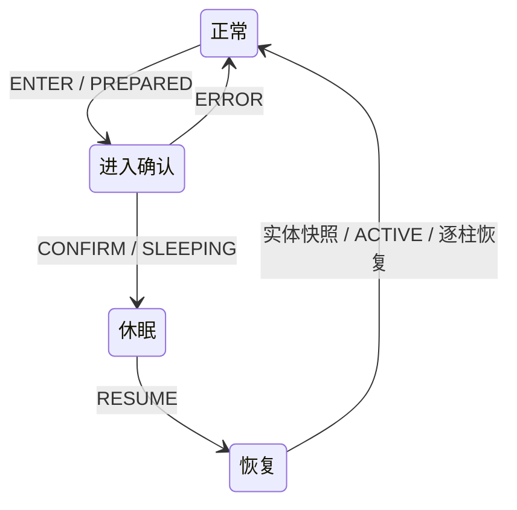

# 半在线休眠与同连接恢复

`2.0.0` 的休眠从 2026-10-23 起采用实际驻留收缩：客户端活动范围收缩到脚下区块及周围八柱，即 **3×3 区块柱**；另留一圈光照与建模邻柱，原生缓存共 **5×5（9 活动 + 16 邻柱）**，更远区块真正卸载。影子缓存保留恢复基线。服务端挂机范围不变，唤醒在原连接恢复。首批启用组合为 **1.20.1 Forge、1.21.1 NeoForge**；现扩展到 `versionProperties` 所列全部 1.21.x 加载器组合，1.20.1 Fabric 保持不协商。

## 开关与使用

服务端配置 `hassium/hassium-server.toml`：

```toml
[master]
sleepEnabled = false
```

总开关**默认关闭**。服务端显式设为 `true` 后，双端具备所需区块能力的连接才协商 `SLEEP`，客户端暂停菜单才显示“进入休眠”。未开启时，手动与自动休眠均不可用。开关在登录时参与协商，修改后重新进服生效。

设置页可编辑自动进入的等待分钟数，**默认 15 分钟**；`1–60` 为有效分钟数，`0` 关闭自动进入。设置按服务器地址和客户端玩家身份保存到 `config/hassium/sleep-profiles.properties` 的 `<身份哈希>.autoSeconds`，文件单位为秒（默认 `900`，允许 `0` 或 `60–3600`）。这是客户端偏好，不是服务端配置键。保存后可继续游戏，也可手动立即进入。

攻击、长按使用及周期点击不重置计时。位置累计偏移超过 0.01 格、视角偏移超过 0.1 度，或按移动、跳跃、潜行、疾跑键时重新计时。聊天、背包、菜单、加载覆盖层、乘坐、睡床与未协商连接不计时。断连、换世界及超过 1 秒的客户端 tick 间隔均重置计时。

**Esc、方向/跳跃/潜行/疾跑输入、相对入眠视角累计转动 20°**唤醒。转向取 yaw 最短环绕差与 pitch 差的二维长度；轻微抖动、攻击和使用不唤醒。移动/转向只在没有菜单或加载覆盖层时检测。Esc 保留原版暂停菜单与按键释放行为。移动/转向恢复不清空按键，不停止使用或挖掘，也不生成点击。

自动进入握手不切换界面、不抓取鼠标、不清空按键。手动进入仅在关闭设置页时恢复菜单前的攻击/使用长按；真实松开事件继续生效，网络确认不重放按键快照。被拒绝时仅显示原因并重置计时。

## 局部同步与恢复

休眠保留 HUD，活动范围是玩家脚下区块及周围八个相邻区块，包含全部高度。原生 `ClientChunkCache` 保留 **25 柱：9 活动柱 + 16 光照/建模邻柱**；邻柱不参加客户端方块实体 tick。再远的柱经原生 `Storage.replace → ClientLevel.unload` 真正卸载并移除方块实体；替换整个区块缓存的实现使用它自己的 `drop`。保留附近原有区块对象与交互，禁止 OVD 或排队应用重新填回更远区块。功能不增加自动点击或服务端动作托管。

这圈原生邻柱不可只留影子端：原版网格构建会查询相邻区块，Sodium/Embeddium 还要求完整 3×3 邻域的 block/light 状态。仅保留 9 个原生区块会使外围八柱不能正常建模，出现脚边即边界。现在由原生邻域就绪规则得到完整的 3×3 画面，不添加替代渲染器专用放行钩子。

视距采用临时运行时覆盖，不改写视频设置、不向服务端广播更小的玩家视距；渲染器通过正常卸载/重建生命周期收缩，而非逐网格隐藏。客户端仍执行附近世界 tick、输入和交互目标检测。由于原版接管链平时抑制增量光包，休眠期间单独放行服务端对 **3×3 活动柱**的原生增量光照，保证邻柱中新光源/遮挡的边界变化仍能到达；初始 LIGHT 齐套门禁不变。

唤醒补回远处实体，撤销运行时视距覆盖并恢复原选块窗口。对需要重建的柱失效权威确认、拉取去重与落地凭据，复用 tracking → ShadowPull → 注入 → 光照 → 客户端应用流程。先在休眠门仍关闭时原生卸载 16 根非活动邻柱，再重新取得当前 BE NBT，避免旧的邻柱 BE 在恢复阶段提前显示；附近 9 柱保持原对象。保留影子缓存基线参与比较：未变化地形走 `UNCHANGED` 并补齐当前 BE NBT，方块变化走 `DELTA`，缓存缺失或失败时走 `FULL`。没有按旧休眠协议强制 FULL 的分支。

每柱使用请求标识拒绝旧响应和旧光照回传。服务端采集快照后短暂暂存该柱后续更新；客户端实际应用后确认，服务端按序补发更新，恢复数据新鲜度。渲染跟随原生区块加载，不使用专门的渲染器隐藏钩子。溢出后重新获取当前快照，不回放截断历史；休眠期间不积压远处历史包。附近交互柱、连接、世界和玩家均不重建。

`LightNeighborhoodGate` 的 3×3 齐套门禁、原交付域、实体共享运动基线及 dirty 状态保持不变。窗口期间暂停远处 ShadowPull、缓存发布和 OVD 补扫。跨脚下区块边界也会唤醒，避免固定窗口遗落玩家。服务端真实玩家的加载和模拟范围不变。

## 协议与边界

只有 `SLEEP` 一个位表示完整的当前休眠协议；它依赖双方的 `PULL_MODE`、`SHADOW_PULL` 与 `PULL_NBT`。缺少任一能力时不启用休眠。未发布中间设计的 `SLEEP_WAKE_ATTEMPT`、`SLEEP_IN_PLACE`、`SLEEP_WINDOW` 及旧操作已删除，不维护它们的兼容路径。



控制消息绑定原生连接、休眠代次及递增序号，限制长度并拒绝尾随数据。它是 egress v3 的 FIFO 屏障，已编码或进入聚合历史的字节仍按序交付。实体补发只读构建快照，先补齐端点，再补乘客/拴绳关系，不清理原生共享 dirty，不修改其他观察者的运动基线。

没有残血保护、血量阈值、保护断线、自动重连、临时保载或强制 tick 票据。受伤走原版及其他模组处理；死亡结束休眠并恢复同步，不因血量主动断线。普通断线后使用正常连接入口。

不再按已安装模组 ID 或自定义包命名空间一概拒绝休眠、主动断连。自定义 payload 继续走原有原生路径；Hassium 只按已知包语义处理自己的区域节流，不能承诺任意第三方 payload 都可节省流量。影子引擎不支持的维度不允许进入休眠。矩阵外的 Minecraft 版本/加载器不协商此能力。已知世界包从异步线程发出时的顺序保护仍保留。

Sodium、Embeddium、Xenon 不再被资源检测禁用休眠；采用相同的客户端区块卸载与视距生命周期，没有这些渲染器的专用绘制 Mixin。实际覆盖的版本和场次见本轮验收记录。

Farsight 4.5 替换了整个客户端缓存，实际区块不在原版 Storage 中；其休眠适配枚举实际 Map，并调用 Farsight 自己覆盖的原生 `drop`，保留其卸载事件与渲染器回调。只在休眠期间收缩，不改 Farsight 配置，也不保留一份远处客户端区块对象。影子缓存仍用于恢复。

部分缓存实现更新已有区块时也调用 `ClientLevel.unload` 清理旧 BE 状态。Hassium 在自己的原生包应用作用域内保护同一柱的恢复凭据，原版卸载仍执行；其他柱的真正移出以及应用失败后的卸载仍正常失效。

## 验证

下列 2026-10-21 至 2026-10-23 场次是跨 1.21.x 扩展前的历史验收，只证明当时启用的组合及其列明场景。全 1.21.x 扩展需另行按七段锚点编译与真实休眠场景验收；这些历史 PASS 不能代表新增组合已通过运行时验证。

2026-10-23 重验完成：七个锚点及适用加载器编译和版本扫描通过，1.20.1 / 1.21.1 / 1.21.11 累计 **1913 项单测通过、8 项跳过、零失败**。新候选 **11 个真实客户端场次全部通过**：原版、Embeddium 0.3.31 + Farsight 4.5、Sodium 0.6.13 的九色区块画面与真实 BE tick 循环；Embeddium + Balm/Waystones；完整 ATM9（客户端 434 / 服务端 423 JAR）和 ATM10（492 / 479，Sodium 0.8.13）；Forge 自动进入、两端关闭开关，以及两端各三组远处工厂对照。工厂在 3×3 外，产量与相邻正常采样的差异均在 1.4% 内；恢复、光照、纯 BE NBT、更新尾部与输入连续性通过。测试使用可见 GUI 的独立副本，没有控制桌面或修改原 HMCL 实例和个人存档。原配置/字典/options/偏好 20 项恢复核验一致。场次、哈希、截图及历史失败见[本轮验收记录](handoff/sleep-residency-2026-10-23-results.json)。

之前仅留下 9 个原生区块的候选存在画面缺陷：替代渲染器只有中央柱具备完整建模邻域，站位又在本柱角上，导致边界贴脚。旧场次的原始 PASS 仅代表当时的数据/恢复门禁，不能替代本轮实际九柱画面验证；原始记录未改标。当前九柱以脚下区块为中心、按区块边界对齐，总宽 48 格，正常最近外边界应在约 16 格以外。

当前场景及复跑方式见[运行时冒烟](runtime-smoke-test.md#半在线休眠专项2x)：`sleepdisabled`、`sleepauto`、`sleepgeometry`、`sleepresume`、`sleepmixed`、`sleepwindowtraffic`、`sleepfactory`。

2026-10-21 的[缓存与 NBT 验证](handoff/cache-nbt-sleep-recovery-2026-10-21-results.json)以及[各轮流量记录](handoff/handoff-2026-10-21-semi-online-sleep.md)保留为历史证据。它们包含已删除的未发布中间设计，不能视为当前协议或本次改动的验收结果。

2026-10-22 清理后验收：七个锚点的 common 与适用加载器编译通过，重点组合构建通过；Forge / NeoForge 分别 **515 / 508** 项单测零失败。两端各 `sleepdisabled`、`sleepauto`、`sleepresume` 三个真实客户端场次全部 PASS，覆盖关闭开关、15 分钟设置保存、输入连续性、远处方块与 BE 更新、屋檐邻柱光照，以及 6 HP 时继续休眠在线。自动进入场景仅测试时缩短等待期限。每端 10 项配置/字典/options/偏好文件的存在性及 SHA256 恢复核验一致；完整场次、最终产物哈希与诊断日志清理口径见[2026-10-22 历史验收记录](handoff/sleep-cleanup-2026-10-22-results.json)。
