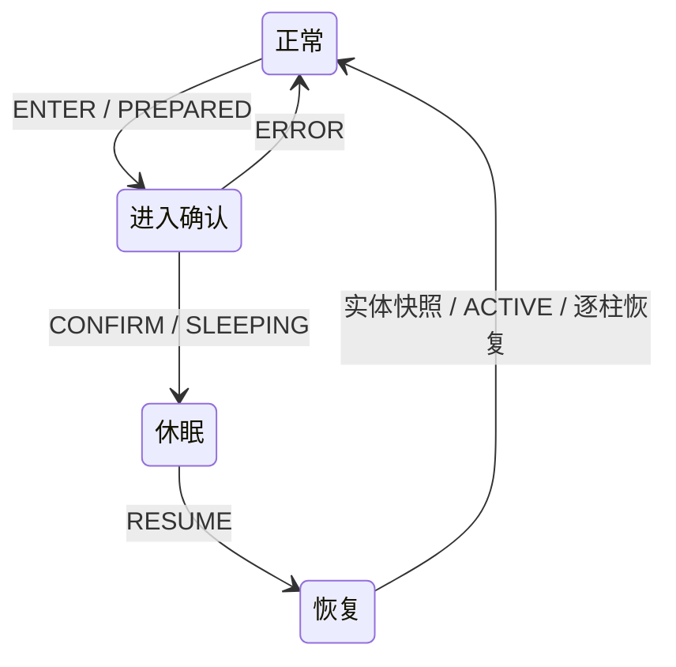

# 半在线休眠与同连接恢复

`2.0.0` 的休眠只保留当前一种设计：客户端保留附近 3×3 区块的原生画面与交互，暂停远处同步；唤醒后在原连接恢复。首批启用组合为 **1.20.1 Forge、1.21.1 NeoForge**。

## 开关与使用

服务端配置 `hassium/hassium-server.toml`：

```toml
[master]
sleepEnabled = false
```

总开关**默认关闭**。服务端显式设为 `true` 后，双端具备所需区块能力的连接才协商 `SLEEP`，客户端暂停菜单才显示“进入休眠”。未开启时，手动与自动休眠均不可用。开关在登录时参与协商，修改后重新进服生效。

设置页可编辑自动进入的等待分钟数，**默认 15 分钟**；`1–60` 为有效分钟数，`0` 关闭自动进入。设置按服务器地址和客户端玩家身份保存到 `config/hassium/sleep-profiles.properties` 的 `<身份哈希>.autoSeconds`，文件单位为秒（默认 `900`，允许 `0` 或 `60–3600`）。这是客户端偏好，不是服务端配置键。保存后可继续游戏，也可手动立即进入。

攻击、长按使用及周期点击不重置计时。位置累计偏移超过 0.01 格、视角偏移超过 0.1 度，或按移动、跳跃、潜行、疾跑键时重新计时。聊天、背包、菜单、加载覆盖层、乘坐、睡床与未协商连接不计时。断连、换世界及超过 1 秒的客户端 tick 间隔均重置计时。

**Esc、方向/跳跃/潜行/疾跑输入、相对入眠视角累计转动 20°**唤醒。转向取 yaw 最短环绕差与 pitch 差的二维长度；轻微抖动、攻击和使用不唤醒。移动/转向只在没有菜单或加载覆盖层时检测。Esc 保留原版暂停菜单与按键释放行为。移动/转向恢复不清空按键，不停止使用或挖掘，也不生成点击。

自动进入握手不切换界面、不抓取鼠标、不清空按键。手动进入仅在关闭设置页时恢复菜单前的攻击/使用长按；真实松开事件继续生效，网络确认不重放按键快照。被拒绝时仅显示原因并重置计时。

## 局部同步与恢复

休眠保留 HUD，只渲染脚下区块及周围一圈，即 **3×3 区块柱（全部高度）**。额外一圈原生光照邻柱形成 **5×5 同步/计算范围**，邻柱不进入可见区。远处区块、方块实体、光照和位置事件暂停交付；客户端仍 tick 并检测交互目标。功能不增加自动点击或服务端动作托管。

唤醒补回远处实体，并恢复原来的选块窗口。只失效暂停区块的权威确认、拉取去重与落地凭据，复用 tracking → ShadowPull → 注入 → 光照 → 客户端应用流程。保留本地缓存基线参与比较：未变化地形走 `UNCHANGED` 并补齐当前 BE NBT，方块变化走 `DELTA`，缓存缺失或失败时走 `FULL`。没有按旧休眠协议强制 FULL 的分支。

每柱使用请求标识拒绝旧响应和旧光照回传。服务端采集快照后短暂暂存该柱后续更新；客户端实际应用后确认，服务端按序补发更新，再开放渲染。溢出后重新获取当前快照，不回放截断历史；休眠期间不积压远处历史包。附近交互柱、连接、世界和玩家均不重建。

`LightNeighborhoodGate` 的 3×3 齐套门禁、原交付域、实体共享运动基线及 dirty 状态保持不变。窗口期间暂停远处 ShadowPull、缓存发布和 OVD 补扫。跨脚下区块边界也会唤醒，避免固定窗口遗落玩家。服务端真实玩家的加载和模拟范围不变。

## 协议与边界

只有 `SLEEP` 一个位表示完整的当前休眠协议；它依赖双方的 `PULL_MODE`、`SHADOW_PULL` 与 `PULL_NBT`。缺少任一能力时不启用休眠。未发布中间设计的 `SLEEP_WAKE_ATTEMPT`、`SLEEP_IN_PLACE`、`SLEEP_WINDOW` 及旧操作已删除，不维护它们的兼容路径。



控制消息绑定原生连接、休眠代次及递增序号，限制长度并拒绝尾随数据。它是 egress v3 的 FIFO 屏障，已编码或进入聚合历史的字节仍按序交付。实体补发只读构建快照，先补齐端点，再补乘客/拴绳关系，不清理原生共享 dirty，不修改其他观察者的运动基线。

没有残血保护、血量阈值、保护断线、自动重连、临时保载或强制 tick 票据。受伤走原版及其他模组处理；死亡结束休眠并恢复同步，不因血量主动断线。普通断线后使用正常连接入口。

服务端模组兼容清单仍只包含原版、加载器基础模块与 Hassium；未知世界同步包和异步世界发包需要明确适配。影子引擎不支持的维度不允许进入休眠。其他 Minecraft 版本/加载器不协商此能力。

客户端使用 Sodium、Embeddium、Xenon 等替代地形渲染器时，目前不协商休眠能力，也不应用原版地形休眠渲染钩子；这些渲染器尚无 3×3 休眠窗口适配。区块缓存和网络功能仍可正常协商。

## 验证

当前场景及复跑方式见[运行时冒烟](runtime-smoke-test.md#半在线休眠专项2x)：`sleepdisabled`、`sleepauto`、`sleepresume`、`sleepmixed`、`sleepwindowtraffic`、`sleepfactory`。

2026-10-21 的[缓存与 NBT 验证](handoff/cache-nbt-sleep-recovery-2026-10-21-results.json)以及[各轮流量记录](handoff/handoff-2026-10-21-semi-online-sleep.md)保留为历史证据。它们包含已删除的未发布中间设计，不能视为当前协议或本次改动的验收结果。

2026-10-22 清理后验收：七个锚点的 common 与适用加载器编译通过，重点组合构建通过；Forge / NeoForge 分别 **515 / 508** 项单测零失败。两端各 `sleepdisabled`、`sleepauto`、`sleepresume` 三个真实客户端场次全部 PASS，覆盖关闭开关、15 分钟设置保存、输入连续性、远处方块与 BE 更新、屋檐邻柱光照，以及 6 HP 时继续休眠在线。自动进入场景仅测试时缩短等待期限。每端 10 项配置/字典/options/偏好文件的存在性及 SHA256 恢复核验一致；完整场次、最终产物哈希与诊断日志清理口径见[本次验收记录](handoff/sleep-cleanup-2026-10-22-results.json)。
