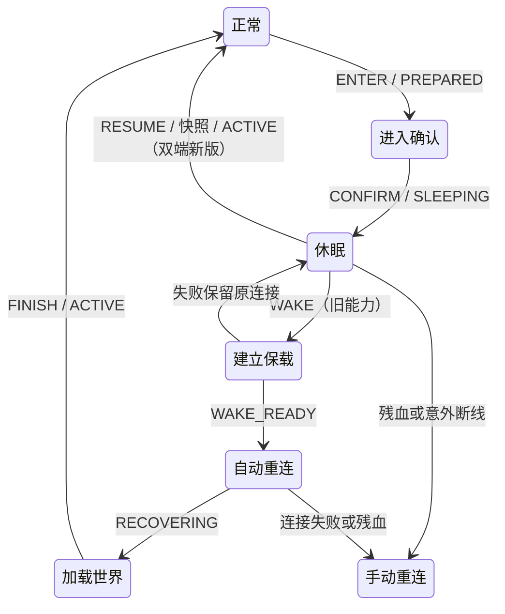

# 半在线休眠与同连接恢复

`2.0.0` 的半在线休眠保留服务端真实玩家及客户端原生交互，暂停远处实体同步。支持手动进入与站桩自动进入，双端新版可在同一连接恢复。首批启用组合为 **1.20.1 Forge、1.21.1 NeoForge**。其他版本与加载器不协商休眠能力，沿用已有同步行为。

## 使用方式

在暂停菜单选择“进入休眠”，设置残血掉线阈值后进入。默认 **6 生命点，即 3 颗心**；`0` 关闭保护。偏好按服务器地址和客户端玩家身份保存到 `config/hassium/sleep-profiles.properties`，服务端验证并回显实际生效值。

默认位置、视角持续稳定 **3 分钟**后自动进入；同一设置页可切换为关闭、3、5、10 分钟，“保存设置并返回游戏”只保存设置。攻击、长按使用及周期点击不重置计时。位置累计偏移超过 0.01 格、视角偏移超过 0.1 度，或按移动、跳跃、潜行、疾跑键时重新计时；聊天、背包、菜单、加载覆盖层、乘坐、睡床、低血量与未协商连接不计时。断连、换世界及超过 1 秒的客户端 tick 间隔均重新计时，避免从挂起恢复时立即进入。

双端协商同连接恢复后，**Esc、方向/跳跃/潜行/疾跑输入、相对入眠视角累计转动 20°**均恢复同步。转向取 yaw 最短环绕差与 pitch 差的二维长度；轻微抖动不唤醒，攻击和使用不唤醒。移动/转向仅在没有菜单或加载覆盖层时检测。Esc 仍按原版打开暂停菜单并允许释放按键；恢复确认不会关闭此菜单。移动/转向恢复不重建连接、世界或玩家，不清空按键，不调用停止使用/挖掘，不生成点击；键盘随后真实松开仍正常生效。

自动进入握手不打开或关闭界面，不抓取鼠标，不清空按键，也不生成点击。手动菜单进入只在关闭设置页时恢复之前保存的攻击/使用长按；随后真实松开事件继续生效。进入确认期间保持原生交互，服务端确认返回时不重放按键快照。自动进入被拒绝时只提示原因，不弹面板，并从完整静止周期重新计时。保护阈值仍由服务端验证，恢复重连期间仍阻断输入。

休眠不遮挡世界，保留 HUD。双端协商 `SLEEP_WINDOW` 时，仅渲染脚下区块及周围一圈，即 **3×3 区块柱（全部高度）**；另保留一圈光照邻柱，形成 **5×5 同步/计算范围**，邻柱不额外进入可见区。远处区块、方块实体、光照及位置事件暂停同步。客户端仍 tick 并检测交互目标，已有长按、连点与客户端宏继续走原生交互；功能不生成点击，也不在服务端托管动作。

唤醒在原连接上补回远处实体，并恢复原来的选块窗口。只失效暂停区块的权威确认、拉取去重和落地凭据，沿现有 tracking → ShadowPull → 注入 → 光照 → 客户端应用流程重新加载。双端协商 `PULL_NBT` 时保留本地基线参与比较：未变化地形走 `UNCHANGED` 并补齐当前 BE NBT，方块变化走 `DELTA`，缺失或失败才走 `FULL`；未协商时保留原强制 FULL 恢复。必要光照邻柱仍受原有 3×3 齐套门禁约束。附近正在交互的区块不卸载，不重建世界、玩家或连接，不建立重连保载票据。

恢复期间每柱使用请求标识拒绝旧响应和旧光照回传。服务端在 `UNCHANGED` / `DELTA` / `FULL` 快照采集之后短暂暂存该柱后续更新，客户端实际应用后确认，服务端按序补发更新，再开放该柱渲染。暂存溢出时重新取当前快照，不回放截断历史；整个休眠期不积压远处历史包。2026-10-21 首轮强制 FULL 方案的 3.70–3.84 MiB 恢复流量保留为历史对照；缓存恢复的复测见[验证与流量记录](handoff/handoff-2026-10-21-semi-online-sleep.md)，不能将两种实现的数字混用。

若对端只协商旧 `SLEEP` 能力，仍走原来的深度休眠：Esc 打开恢复面板，恢复先建立临时保载，再授权自动重连一次。登录、缓存比较、世界重建与光照沿用完整加载流程。失败后提供手动重试和剩余宽限；残血及普通意外断线不触发自动重连。

## 配置和兼容范围

| 配置 | 默认 | 范围 |
|---|---|---|
| `master.sleepEnabled` | `true` | 服务端允许已协商连接手动或自动休眠 |
| `master.sleepWakeHoldSeconds` | `300` | 10 至 3600 秒，仅旧重连恢复使用的固定保载期限 |
| 每服务器阈值 | `6` HP | 0 至当前最大生命值，拒绝 NaN 和无穷值 |
| 每服务器自动休眠 | `180` 秒 | 偏好文件中身份哈希加 `.autoSeconds`；0 关闭，文件可设 60–3600 秒；不属于服务端配置键 |

当前服务端兼容清单仅包含原版、加载器基础模块和 Hassium。其他服务端模组在有明确包策略前阻止启用；客户端专用输入模组不因此被排除。运行中遇到未知世界同步包、未适配的异步世界发包、维度或生命状态变化时，连接结束并要求手动重连。依赖渲染回调、特殊声音或自定义目标缓存的宏需要单独适配。

## 状态和消息顺序

`SleepControl` 将消息绑定原生连接、休眠代次及递增序号，限制消息长度并拒绝尾随数据。进入确认前保持正常世界交付。同连接 `RESUMING` 保持输入开放，服务端在一次主线程事务中补实体，待全部端点生成后再补乘客/拴绳关系，随后发 `ACTIVE`。仅旧重连的恢复加载期间双端禁止交互，附近世界就绪后才开放输入。

登录能力 `SLEEP` 表示支持休眠，`SLEEP_IN_PLACE` 表示支持同连接 `RESUME`。新增 `SLEEP_WINDOW` 依赖前两位及 `PULL_MODE`，启用局部窗口和逐柱恢复确认；未协商此位时仍保持先前的地形连续同步行为。影子引擎不支持的维度保留地形同步。新增控制操作追加在枚举尾部，旧序号不变。`SLEEP_WAKE_ATTEMPT` 只标记服务端授权后的单次自动恢复登录。旧客户端不接收新控制操作。

休眠控制是 v3 FIFO 屏障。已编码、压缩或进入聚合历史的字节仍按序交付，不截断历史。过滤发生在原生编码前，原有实体压力计数保留过滤前口径，补发快照不重复计入压力。

## 附近世界和实体基线

附近范围默认 8 格，服务端认可的交互距离更大时使用交互距离加 2 格。涉及的区块保留完整方块更新及光照邻柱；自身鱼漂、投射物和载具乘客保留相关同步。自身修正、生命值、效果、属性、物品栏、交互确认，以及聊天、玩家列表、计分板和协议控制继续交付。

远处实体从该客户端移除，不保留其历史包。窗口休眠期间 ShadowPull、缓存发布收缩到附近，OVD 补扫暂停。脚下区块改变（例如被推走）也触发唤醒，避免固定窗口遗落玩家。3×3 光照邻柱门禁不变，所有模式均不改变真实服务端玩家的加载和模拟范围。

实体进入附近时，`SleepEntityCompat` 只读构建生成、数据、属性、装备、效果、运动和关联状态，先将该客户端的位置解码基线对齐共享 `ServerEntity.positionCodec` 的 **B**，再放行原生相对位移。它不调用会清理 dirty 的原生配对流程，不改共享位置、观察者集合或 dirty 状态。正常观察者继续接收原来的原生包。

## 临时保载（旧能力重连路径）

`ReconnectChunkLeases` 独立于连接，按玩家 UUID 与休眠代次持有记录。只在显式恢复时建立，重复请求复用原记录且不延长截止时间。单玩家最多 8192 柱，全服最多 32768 柱；超限或接管失败保留原连接和休眠状态。

`SleepLeaseCompat` 快照已有 FULL 柱的加载等级和独立 tick 图等级，分别接管加载、方块与实体 tick。加载器强制 tick 标记仅用于原先已处于活动随机 tick 范围的柱，避免扩大随机 tick 范围；无人在线期间重置原生空服计时。全部票据确认生效后才返回恢复就绪。

新连接通过认证并进入世界后，还要证明**不含任何休眠票据的原生票据源**已经覆盖原有加载和 tick 等级，才释放保载。客户端 ACK 或登录事件本身不作为释放依据。到期无条件释放；服务器停止时清理。票据不写入永久强加载数据。

普通残血或意外断线不会新建票据。若玩家已经主动恢复并建好保载，随后在恢复中残血或连接失败，既有记录仍按最初截止时间释放，后续重试不会续期。

临时票据保住区域的加载和 tick；断开及加入事件仍会发生，依赖真实玩家在场的刷怪或机器条件可能短暂停顿。

## 残血结算

服务端实际 `health <= threshold` 触发，吸收生命不参与比较。进入前已经达到阈值时拒绝进入。确认后保护覆盖休眠与自动恢复加载，在原生伤害流程返回后检查，每 tick 再检查一次，覆盖其他方式修改血量。

保护不取消伤害，不更改护甲、减伤、图腾或死亡顺序。触发后服务端直接断开并走原生玩家移除，清理幂等，不等待客户端确认。客户端取消自动恢复，并对随后经原生连接入口发起的重连要求明确手动操作。单次致死伤害仍可能死亡，已发生的死亡不会被撤销。

## 验证入口

实际场次、完整周期流量和兼容限制见[实现验收记录](handoff/handoff-2026-10-21-semi-online-sleep.md)，复跑命令见[冒烟专项](runtime-smoke-test.md#半在线休眠专项2x)。

2026-10-21 最终缓存唤醒验收：Forge `sleepcache_1201_20261021_b`、NeoForge `sleepcache_1211_20261021_a` 均 PASS，单测分别 518 / 511 项零失败。NBT 回归每端 24 项客户端检查通过。输入连续性持续检查到整个可见范围恢复完成，覆盖真实拉弓和持续挖掘，Esc 原版释放除外；恢复已实测使用 UNCHANGED / DELTA。详见[机器可读结果](handoff/cache-nbt-sleep-recovery-2026-10-21-results.json)与[流量对比](handoff/handoff-2026-10-21-semi-online-sleep.md)。

开发冒烟场景在 `common/src/main/resources/hassium/smoke/scenario/`：

| 场景 | 验证内容 |
|---|---|
| `sleep` | 最后一名玩家退出 20 秒、区块对象不变、无卸载、实际漏斗 ticker、重连和缓存更新 |
| `sleepauto` | 界面阻止自动进入、真实握手中持续按住攻击/使用、释放输入、无遮挡截图及保载重连；仅测试缩短站桩期限 |
| `sleepresume` | 3×3 实际地形渲染及 5×5 光照邻柱；转向/移动/Esc/疾跑输入同连接恢复；逐 tick 检查攻击/使用、真实拉弓计时和挖掘进度直到整个可见范围恢复完成；远处方块、纯 BE NBT 与快照后更新补齐；屋檐边界光照；连接/世界/玩家/附近实体身份不变；不产生保载票据 |
| `sleepmixed` | 两个真实客户端、近远实体出入、相对运动恢复、目标死亡替换、装备耐久 |
| `sleepsafety` | 阈值相等、吸收生命和图腾、直接改血、恢复中受伤、致死伤害和手动重连 |
| `sleepexpiry` | 10 秒测试期限到期释放，单次自动恢复不再执行 |
| `sleeptraffic` | 同一原生工厂的站桩、长按、间隔攻击，分别测正常、休眠及完整重连周期 |
| `sleepfactory` | 仅 1.21.1，使用用户工厂 ZIP 的独立副本，在既定挂机点测上述三种周期 |
| `sleepwindowtraffic` | 两重点版本各自生成相同布局的原版工厂；正常/3×3 休眠/同连接恢复实际 TCP 流量、视野恢复就绪、工厂产量与 TPS |

`sleepfactory` 在副本的 `(72,77,79)` 放置一块基岩作为不可破坏的输入目标，在其上以生存模式测试，并给予抗性以隔离样本意外伤害；原 ZIP 不改动。它与独立生成的 1.20.1 工厂分别报告，不能直接归因于版本差异。测试预热时冻结，测量前解冻并恢复 20 TPS。故障场景将期限缩短至 10 秒；生产默认值仍为 300 秒。

`SleepRuntimeProbe` 仅在开发冒烟开关下核验真实区块对象、卸载回调与执行过的漏斗 ticker。流量探针计入成功写出的所有协议阶段 TCP 应用载荷和 Minecraft 帧头，包含重连登录；不含 TCP/IP 头、重传或客户端上传。流量分析入口为 `scripts/smoke/analyze-sleep-traffic.py`，会计算保守和扣除正常同期流量后的回本时间。

重连验收还修复了旧版 `PalettedContainer.copy()` 的可变副本问题：其 resize 回调可能仍指向原容器，增量扩展调色板会越界。可变增量目标现在通过独立原生读写副本持有自己的回调，两个测试覆盖调色板跨 16、32、64 项扩容和原基线不变。

社区设计参考由 XERJ 检索 [BandwidthOptimizer](https://github.com/duckgun13476/BandwidthOptimizer) 的恢复协调方式，修订 `87bb5262388b04011b4e8a280f1ab210a12026ef`，`connection/ClientReconnectCoordinator.java:28`。只参考协调思路，未复制 LGPL 代码；本实现遵循单次明确授权、残血优先和固定保载截止时间。
